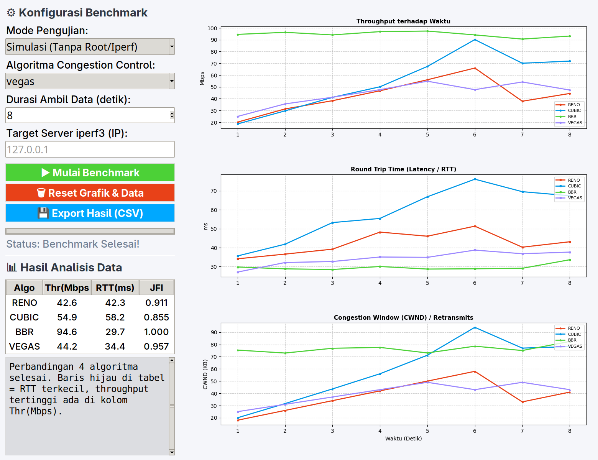

# TCP Congestion Control Benchmark & Analyzer

Aplikasi GUI (Python + tkinter + matplotlib) untuk membandingkan perilaku algoritma
**TCP Congestion Control**: `reno`, `cubic`, `bbr`, dan `vegas`.



## Fitur

| Fitur | Keterangan |
|---|---|
| **Dua mode** | *Simulasi* (model matematis, tanpa root/iperf3) dan *Real Network* (iperf3 asli di Linux) |
| **Overlay grafik** | Hasil tiap algoritma ditumpuk dengan warna berbeda, jadi bisa dibandingkan langsung |
| **3 grafik realtime** | Throughput, RTT (latency), dan CWND terhadap waktu |
| **Tabel perbandingan** | Avg Throughput, Avg RTT, dan Stability Index (JFI) per algoritma |
| **Analisis otomatis** | Avg/Peak throughput, standar deviasi (fluktuasi), min RTT, **JFI**, **Power Metric** (Mbps/ms), plus kesimpulan karakteristik tiap algoritma |
| **Durasi fleksibel** | 5–120 detik per pengambilan data |
| **Export CSV** | Data mentah per detik dari semua algoritma yang diuji |

## Instalasi

```bash
cd ~/Documents/tcp-cc-benchmark
pip install -r requirements.txt
```

Khusus **Mode Real** (Linux):

```bash
sudo apt install iperf3
```

## Menjalankan

```bash
python3 tcp_benchmark_gui.py
```

Cara pakai:

1. Pilih mode (default: **Simulasi**).
2. Pilih algoritma, atur durasi, klik **▶ Mulai Benchmark**.
3. Ulangi untuk algoritma lain — grafik sebelumnya tidak hilang.
4. Lihat tabel + analisis di panel kiri, lalu **💾 Export Hasil (CSV)** bila perlu.

## Mode Real (iperf3)

1. Jalankan server di mesin tujuan: `iperf3 -s`
2. Di aplikasi: pilih **Real Network (Linux iperf3)**, isi IP server, klik mulai.
3. Aplikasi menjalankan `iperf3 -c <ip> -t <durasi> -C <algoritma> -J` dan mem-parse
   output JSON-nya (throughput, RTT, snd_cwnd).

Catatan:

* Algoritma harus tersedia di kernel. Cek dengan:
  `sysctl net.ipv4.tcp_available_congestion_control`
* `iperf3 -C` tidak butuh root, tetapi modul `tcp_bbr` mungkin perlu dimuat:
  `sudo modprobe tcp_bbr`
* Pada loopback, RTT bisa terbaca sangat kecil (~0,1 ms) dan throughput sangat besar —
  itu normal karena tidak melewati jaringan fisik.

## Struktur proyek

```
tcp-cc-benchmark/
├── tcp_benchmark_gui.py     # aplikasi utama
├── requirements.txt
├── docs/screenshot.png
└── tests/
    ├── smoke_test.py        # uji otomatis: simulasi + tabel + export CSV
    └── demo_all.py          # demo 4 algoritma berurutan
```

## Pengujian

```bash
python3 tests/smoke_test.py      # butuh display (X11/Wayland)
python3 tests/demo_all.py 8 30   # durasi 8 s per algoritma, jendela terbuka 30 s
```

## Metrik yang dihitung

| Metrik | Rumus / Arti |
|---|---|
| Avg / Peak Throughput | rata-rata dan puncak bandwidth (Mbps) |
| Std Throughput | fluktuasi/kestabilan throughput |
| Avg / Min RTT | latency rata-rata dan terendah (ms) |
| **JFI** | `(Σx)² / (n · Σx²)` — indeks stabilitas alokasi bandwidth, ideal 1.0 |
| **Power Metric** | `throughput / delay` (Mbps/ms), semakin tinggi semakin efisien |

## Troubleshooting

| Masalah | Solusi |
|---|---|
| `iperf3 tidak ditemukan` | `sudo apt install iperf3` |
| `Connection refused` | Server belum jalan: `iperf3 -s` di mesin tujuan |
| `unable to set congestion control` | Algoritma tidak didukung kernel; cek `sysctl net.ipv4.tcp_available_congestion_control` |
| Jendela terpotong di HiDPI | Ukuran jendela otomatis mengikuti resolusi layar; perkecil *text scaling* desktop bila masih sempit |
| Grafik RTT datar di mode Real | Server/klien iperf3 lama tidak mengirim statistik `rtt`; perbarui iperf3 ≥ 3.7 |
